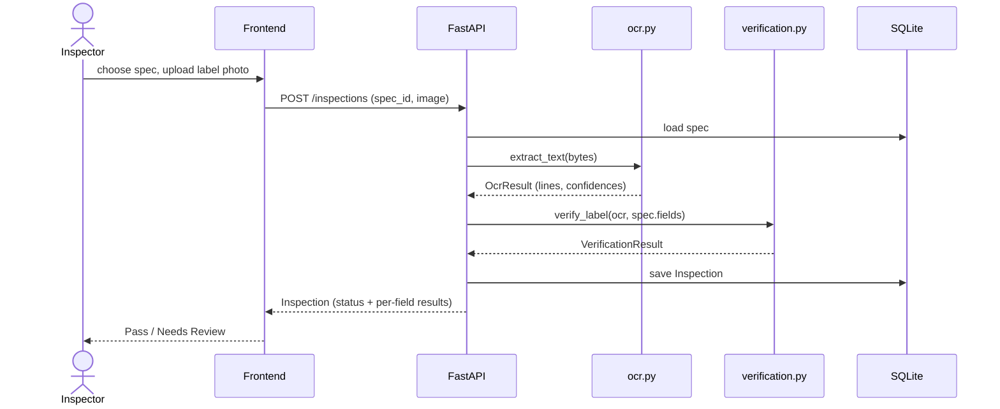

# Architecture

**Owner:** Tray · see also [api-contract.md](api-contract.md) and [adr/](adr/)

## What it does
A quality inspector saves an approved product label spec (brand, net contents, allergens, ...), then uploads a photo of the printed label. The system reads the label text with OCR, compares each field to the spec, and returns **Pass** or **Needs Review** with a reason for each field. Every inspection is saved so it can be reviewed later.

## Components

| Component | Path | Owner | Responsibility |
|---|---|---|---|
| Web UI | `frontend/` (Next.js + TS) | Wenyi | Spec form, upload, results, history |
| API | `backend/app/main.py` | Amzad | HTTP routes, validation, orchestration |
| OCR | `backend/app/ocr.py` | Tray | Image → `OcrResult` (text + line confidences) |
| Verification | `backend/app/verification.py` | Amzad | `OcrResult` + spec → per-field status |
| Storage | `backend/app/database.py`, `models.py` | Amzad | SQLite: `product_specs`, `inspections` |
| CI/CD and hosting | `.github/workflows/`, deploy config | Vincent | Checks on every PR, public deploy |
| Test data | `data/sample_labels/` | Tray | Synthetic labels with known expected results |

## Inspection flow

## Who decides what
| Decision | Single owner |
|---|---|
| What text is on the label | `ocr.py` |
| Whether a field matches | `verification.py` (the frontend only displays; it never re-checks) |
| What the label *should* say | the saved `ProductSpec` |

## Decisions
- [0001: OCR engine](adr/0001-ocr-engine.md)
- SQLite over Postgres: zero setup, one file, enough for a demo. *TODO(Amzad/Vincent): confirm the host keeps a persistent disk, or history is lost on redeploy.*
